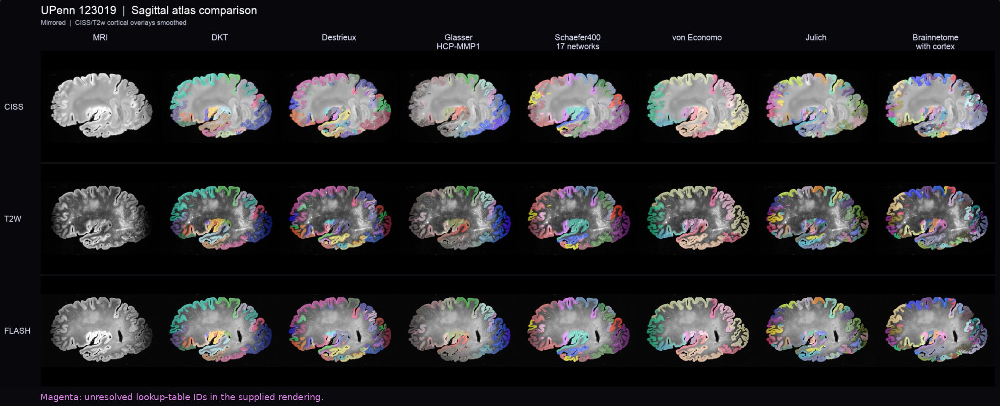
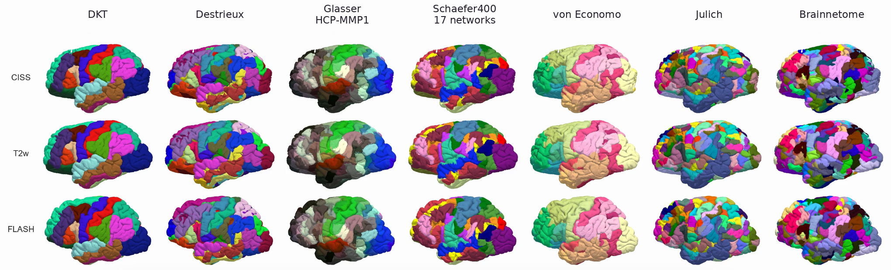
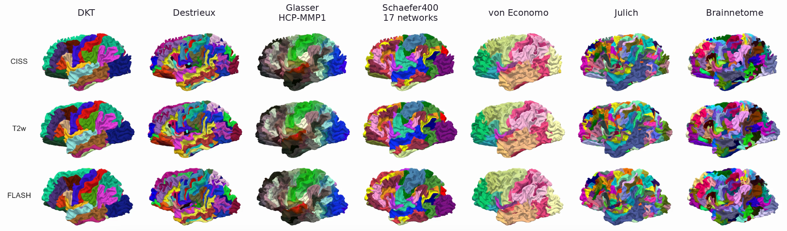
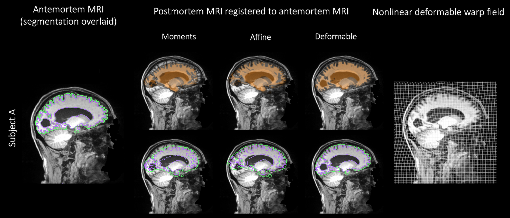
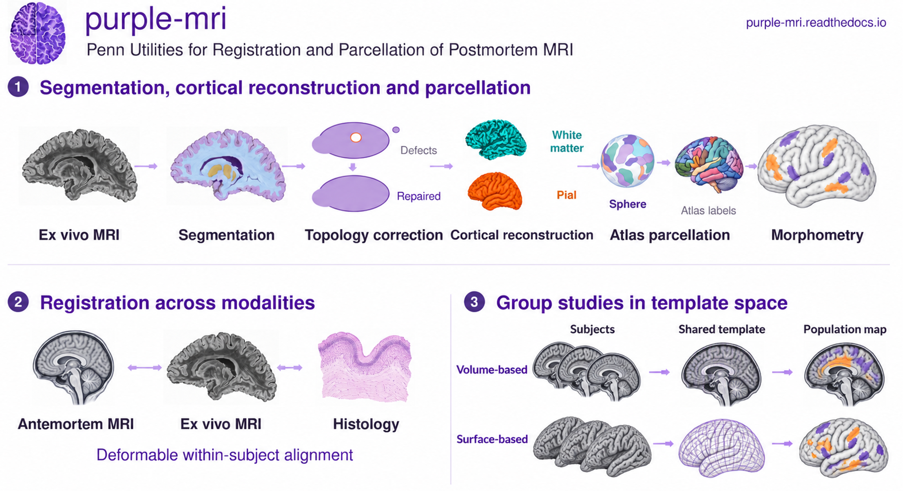
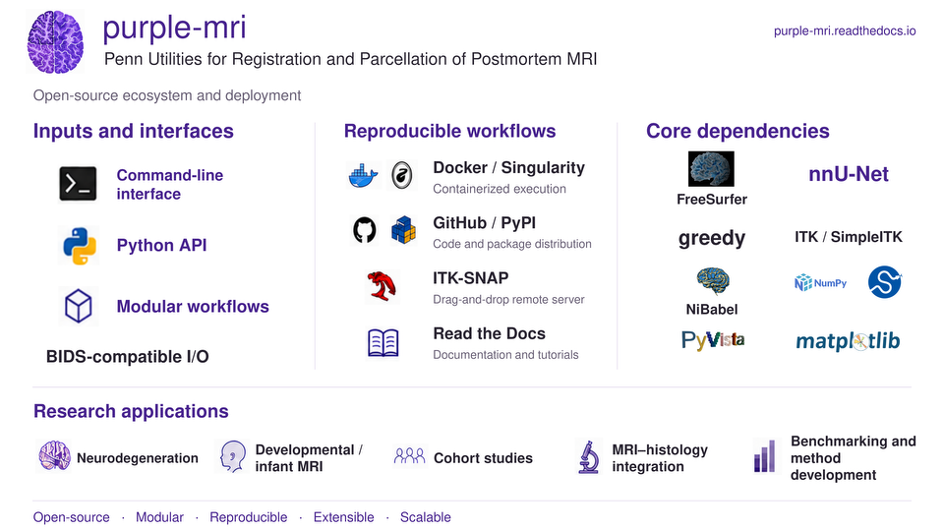
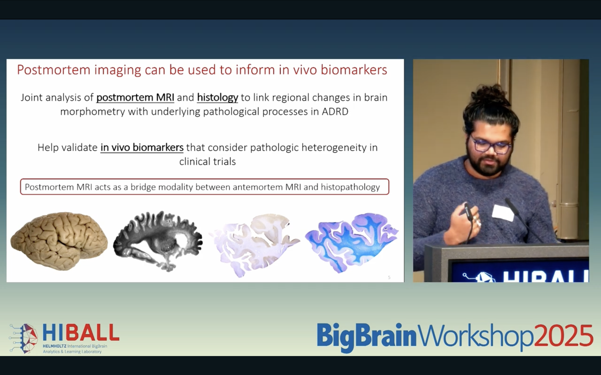

# purple-mri

**Penn Utilities for Registration and Parcellation of Ex vivo MRI**

`purple-mri` provides segmentation, cortical surface reconstruction, anatomical
parcellation, registration, and morphometric analysis of high-resolution
postmortem human brain MRI.

[Documentation](https://purple-mri.readthedocs.io/en/latest/) ·
[PyPI](https://pypi.org/project/purple-mri/) ·
[Docker image](https://hub.docker.com/r/pulks/docker_purple_mri) ·
[Singularity SIF](https://purple-mri.readthedocs.io/en/latest/singularity.html) ·
[Release notes](https://purple-mri.readthedocs.io/en/latest/release_notes.html)

## Results across MRI contrasts

Examples from the UPenn postmortem MRI workflows. Select any figure to open its full-resolution PNG.

### MRI and volumetric parcellation

[](docs/source/_static/examples/01_volume_atlas_comparison.png)

Sagittal MRI and seven cortical atlas overlays for UPenn subject 123019, with CISS, T2w and FLASH in rows. Columns show MRI, DKT, Destrieux, Glasser/HCP-MMP1, Schaefer400 (17 networks), von Economo, Julich and Brainnetome. The display is mirrored; CISS/T2w overlays are smoothed for visualization. Magenta indicates unresolved lookup-table IDs.

### Cortical surface parcellation

[](docs/source/_static/examples/02_surface_parcellations_view1.png)

Surface parcellations across CISS, T2w and FLASH. Columns follow the same seven-atlas order as the volumetric comparison.

### Additional surface view

[](docs/source/_static/examples/03_surface_parcellations_view2.png)

A second surface view of the seven cortical atlases, with CISS, T2w and FLASH in rows.

### Antemortem–postmortem registration

[](docs/source/_static/examples/04_antemortem_postmortem_registration.png)

Within-subject registration of postmortem MRI to antemortem MRI, shown through moments initialization, affine alignment and deformable registration. Orange overlays show the registered postmortem MRI; green and purple contours show GM/background and GM/WM boundaries. The right panel shows the nonlinear deformation field.

## Workflow overview



The figure summarizes the broader research workflows. For the adult segmentation
and surface pipeline, follow the processing instructions below; see
[other workflows](#documentation-and-other-workflows) for registration, templates,
and group analysis.

## Software ecosystem



## Choose how to run adult processing

| Route | Install on the host | Instructions |
| --- | --- | --- |
| ITK-SNAP / remote DSS | ITK-SNAP, internet access, and an available provider; no local Docker or GPU | [Illustrated ITK-SNAP guide](https://purple-mri.readthedocs.io/en/latest/itksnap.html) |
| Python CLI with Docker | Python 3.9+, Docker, and GPU access for DL | [Installation](https://purple-mri.readthedocs.io/en/latest/installation.html) and [quick start](https://purple-mri.readthedocs.io/en/latest/quickstart.html) |
| Docker directly | Docker and GPU access for DL | [Direct Docker examples](https://purple-mri.readthedocs.io/en/latest/docker.html) |
| Singularity / Apptainer | Compatible Linux runtime and GPU access for DL | [SIF download and usage](https://purple-mri.readthedocs.io/en/latest/singularity.html) |

The local Docker routes use **`pulks/docker_purple_mri:v1.2.0`**. The image supplies
trained models, FreeSurfer, Convert3D, atlas resources and the custom pial binary.
The Python package supplies the launcher. Use a Linux Docker host with NVIDIA GPU
support for inference and a FreeSurfer license for surfaces and atlas processing.

### Install and run locally

```bash
python3 -m venv ~/venvs/purple-mri
source ~/venvs/purple-mri/bin/activate
python -m pip install 'purple-mri==1.2.0'
purple-mri pull
purple-mri doctor

purple-mri run exvivo_dl exvivo_surface \
  --contrast flash --hemi rh \
  --input /absolute/path/inputs \
  --output /absolute/path/new_results \
  --license /absolute/path/license.txt \
  --threads 8 --gpus device=0
```

Use one contrast and hemisphere per batch, with `SUBJECT_0000.nii.gz` inputs.
Choose `t2w`, `ciss`, `flash` or `t2star`, and the actual `lh` or `rh` hemisphere.
The full command performs DL segmentation, tissue cleanup and merging, cortical
reconstruction, Brainnetome annotation correction, atlas projection and seven
atlas merges. FLASH/T2* adds Task278 to the T2w/CISS model foundation.

Add `--dry-run` to print the command. `--preflight-only` runs container input/model
checks; use a separate output directory for its record. See the
[package guide](pkg_src/README.md) for full options and migration from 1.1.0.

### Run stages separately

```bash
purple-mri run exvivo_dl --contrast ciss \
  --input /absolute/path/inputs --output /absolute/path/new_dl_results

purple-mri run exvivo_surface --contrast ciss --hemi lh \
  --input /absolute/path/inputs \
  --dl-dir /absolute/path/new_dl_results/dl \
  --output /absolute/path/new_surface_results \
  --license /absolute/path/license.txt --threads 8

purple-mri run exvivo_flash_gm_wm --contrast flash \
  --input /absolute/path/flash_inputs --output /absolute/path/task278_results
```

Surface processing uses the complete DL root and its `12_surface_labels` map;
it also merges the atlases. Use `exvivo_atlas_merge` with `--dl-dir` and
`--surface-dir` to reuse completed v1.2.0 projections. `exvivo_all` means DL only.

### Find results

| Output | Location beneath a full run's `--output` |
| --- | --- |
| Detailed tissue merge | `dl/11_final_merged/` |
| Reconstruction labels, codes 0–10 | `dl/12_surface_labels/` |
| FLASH/T2* raw and cleaned predictions | `dl/13_flash_task278/`, `dl/13b_flash_task278_cleaned/` |
| Surfaces, annotations, projections and metrics | `surface/SUBJECT/{surf,label,mri,stats,qc}/` |
| Seven final atlas merges and lookup tables | `atlases/SUBJECT/` |
| Individual-model predictions | `predictions/` |
| Container identity, input hashes and actual exit status | `purple_run.json` |

The detailed map retains MTL and subcortical structures, WM 107 and cortical GM
101. Reconstruction uses the collapsed `12_surface_labels` map. Atlas merges
replace generic GM 101 with parcel labels and preserve noncortical structures.
The seven final atlases are DKT, Destrieux, Glasser, Schaefer400, Economo, Julich
and Brainnetome.

The CLI checks run identity before `--resume`; repeat the original command with
that option. Ctrl+C cancels the verified container. Use tmux or a scheduler for
long runs. Check completion markers, reports and anatomical alignment.

### Singularity and remote processing

The published Singularity image is available at:

```bash
singularity pull purple_mri_v1.2.0.sif \
  oras://registry-1.docker.io/pulks/singularity_purple_mri:v1.2.0
```

For ITK-SNAP, select **Tools → Distributed Segmentation Service**, connect to
`https://dss.itksnap.org`, and use the purple service registered for your account.
Follow its input tags and the [service instructions](https://github.com/Pulkit-Khandelwal/purple-dss).
Service availability depends on provider and account access.

## Documentation and other workflows

Read the Docs is the detailed user manual. The [repository container guide](docker/exvivo_docker.md)
also documents direct Docker commands using the older project-folder layout.
The [package README](pkg_src/README.md) covers the Python launcher, and the
[container build guide](docker/docker_files/README.md) is for maintainers.

The repository also contains workflows beyond the adult container commands:

| Workflow | Guide or source |
| --- | --- |
| Ex vivo to in vivo registration | [Registration](https://purple-mri.readthedocs.io/en/latest/registration.html) |
| Population template construction | [Templates](https://purple-mri.readthedocs.io/en/latest/template_construction.html) |
| ROI-wise, vertex-wise, and deformation-based analyses | [Group analysis](https://purple-mri.readthedocs.io/en/latest/group_analysis.html) |
| Infant reconstruction and M-CRIB-S mapping | [Infant scripts](purple_mri/infant_scripts) |
| Historical pip native surface launcher | [Legacy guide](https://purple-mri.readthedocs.io/en/latest/legacy.html) |
| Standalone source surface scripts | [Source workflow distinctions](https://purple-mri.readthedocs.io/en/latest/legacy.html#standalone-repository-scripts) |

Registration, templates, infant reconstruction and group analysis are separate
research workflows. Their host dependencies and setup
are described in their guides; they are not installed by the lightweight CLI.
The adult container already supplies fsaverage, atlas assets, and the custom
pial executable, so users do not need the standalone pial container setup.

## Install from source or contribute

```bash
git clone https://github.com/Pulkit-Khandelwal/purple-mri.git
cd purple-mri
python -m pip install -e .
purple-mri --help
```

Install `dependencies.txt` only when a separate research workflow requires
those host libraries. See the [maintainer guide](https://purple-mri.readthedocs.io/en/latest/publishing.html)
for package checks, documentation builds, and release procedures.

## Development

`purple-mri` was conceived by **Pulkit Khandelwal and Paul A. Yushkevich**
and originated from doctoral research in the PATCH Lab within the Penn Image
Computing and Science Laboratory (PICSL) at the University of Pennsylvania.

The framework was developed through collaborations with the Penn Alzheimer's
Disease Research Center and Penn Frontotemporal Degeneration Center and has
subsequently expanded at Massachusetts General Hospital, Harvard Medical
School, and the Athinoula A. Martinos Center for Biomedical Imaging toward
high-resolution multimodal postmortem imaging of the developing human brain,
including collaborative work with Boston Children's Hospital.

See the documentation homepage for additional background:

https://purple-mri.readthedocs.io/en/latest/


## Introductory Video

<div align="center">
  <a href="https://youtu.be/DBdzbIAJBw4">
    
  </a>
</div>


## Citations

If you use **purple-mri** in academic work, please cite the relevant publications below.

- Khandelwal, P. (2025). *Postmortem Image Analysis of the Human Brain to Characterize Alzheimer’s Disease and Related Dementias*. Doctoral dissertation, University of Pennsylvania.

- Khandelwal, P., et al. (2024). Automated deep learning segmentation of high-resolution 7 Tesla postmortem MRI for quantitative analysis of structure-pathology correlations in neurodegenerative diseases. *Imaging Neuroscience*, 2, 1–30.

- Khandelwal, P., et al. (2026). Postmortem brain MRI reveals differential associations of subcortical and limbic volumes with cortical thinning and neurodegenerative pathologies. *Alzheimer’s & Dementia*, 22(7), e71649.

- Khandelwal, P., et al. (2024). Surface-Based Parcellation and Vertex-wise Analysis of Ultra High-resolution ex vivo 7 Tesla MRI in Alzheimer’s disease and related dementias. In *International Workshop on Machine Learning in Clinical Neuroimaging (MLCN), MICCAI 2024*. Springer, Cham.

- Khandelwal, P., et al. (2025). VIOLET: Volumetric Image Registration via Optimization and Learning for Efficient Image Translation. In *International Workshop on Simulation and Synthesis in Medical Imaging (SASHIMI), MICCAI 2025*. Springer Nature Switzerland, Cham.

- Khandelwal, P., et al. (2026). Cortical reconstruction and anatomical parcellation of high-resolution multi-modal postmortem ex vivo MRI of the human infant brain. In *Preterm, Perinatal and Paediatric Image Analysis (PIPPI) Workshop, MICCAI 2026*.


## License
Please see the repository license for terms of use.
