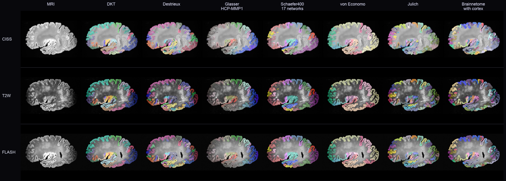
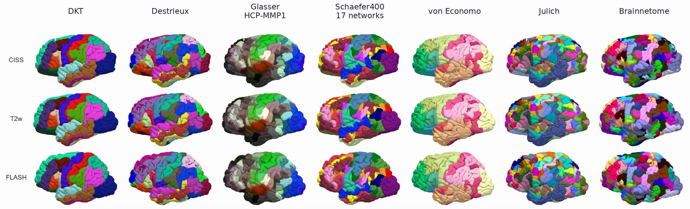
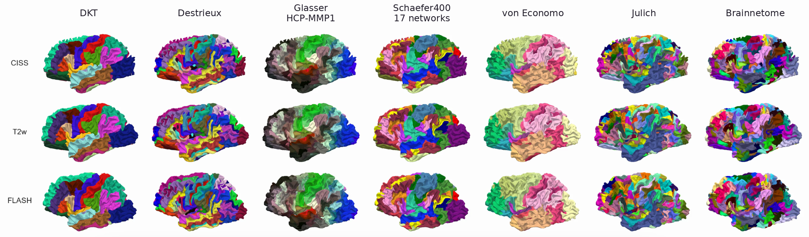
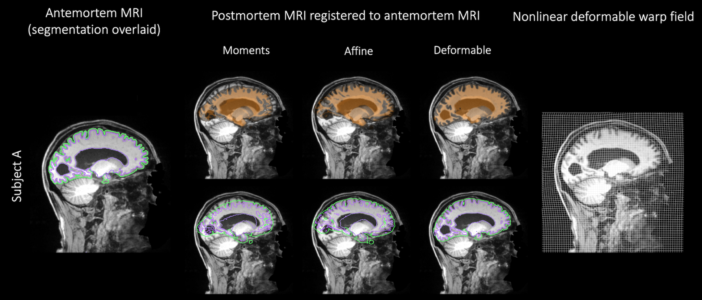
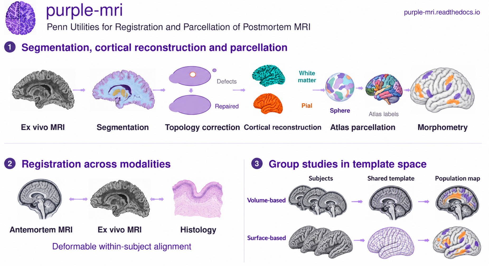
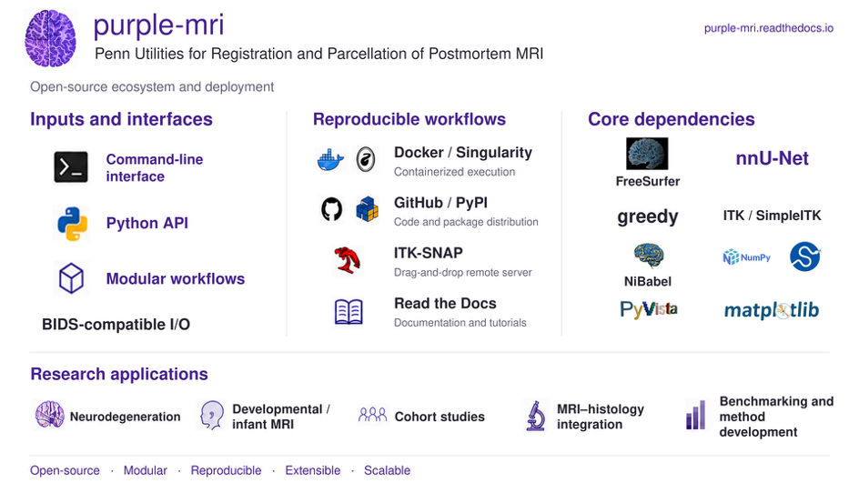

purple-mri
============

``purple-mri`` (Penn Utilities for Registration and Parcellation of Ex vivo MRI)
is a computational framework for segmentation, registration, cortical surface
reconstruction, anatomical parcellation, and group-level analysis of
ultra-high-resolution postmortem human brain MRI.

The toolkit was originally developed for ex vivo whole-hemisphere MRI acquired
at submillimeter resolution, including approximately 300 µm isotropic 7 Tesla
MRI, where conventional in vivo neuroimaging pipelines face challenges related
to fixation-driven contrast changes, specimen-specific geometry, tissue
sampling, and extreme spatial resolution.

``purple-mri`` combines deep learning-based voxel segmentation with classical
image-registration and surface-based modeling methods to produce
topology-corrected cortical reconstructions, native-space anatomical
parcellations, spatial normalization, and vertex-wise morphometric analyses.

Results across MRI contrasts
------------------------------

Examples from the UPenn postmortem MRI workflows. Select a figure to open its full-resolution PNG.

MRI and volumetric parcellation
~~~~~~~~~~~~~~~~~~~~~~~~~~~~~~~~~

w overlays are smoothed for visualization. Magenta indicates unresolved lookup-table IDs.
   :class: purple-example

   Sagittal MRI and seven cortical atlas overlays for UPenn subject 123019, with CISS, T2w and FLASH in rows. Columns show MRI, DKT, Destrieux, Glasser/HCP-MMP1, Schaefer400 (17 networks), von Economo, Julich and Brainnetome. The display is mirrored; CISS/T2w overlays are smoothed for visualization. Magenta indicates unresolved lookup-table IDs.

Cortical surface parcellation
~~~~~~~~~~~~~~~~~~~~~~~~~~~~~~~

   Surface parcellations across CISS, T2w and FLASH. Columns follow the same seven-atlas order as the volumetric comparison.

Additional surface view
~~~~~~~~~~~~~~~~~~~~~~~~~

   A second surface view of the seven cortical atlases, with CISS, T2w and FLASH in rows.

Antemortem–postmortem registration
~~~~~~~~~~~~~~~~~~~~~~~~~~~~~~~~~~~~

 boundaries. The right panel shows the nonlinear deformation field.
   :class: purple-example

   Within-subject registration of postmortem MRI to antemortem MRI, shown through moments initialization, affine alignment and deformable registration. Orange overlays show the registered postmortem MRI; green and purple contours show GM/background and GM/WM boundaries. The right panel shows the nonlinear deformation field.

Start here: adult release 1.2.0
---------------------------------

Install the Python launcher and run the complete segmentation, surface and atlas
workflow on a Linux Docker host:

.. code-block:: bash

   python -m pip install 'purple-mri==1.2.0'
   purple-mri pull
   purple-mri run exvivo_dl exvivo_surface \
     --contrast flash --hemi rh \
     --input /absolute/path/inputs --output /absolute/path/new_results \
     --license /absolute/path/license.txt --threads 8 --gpus device=0

Choose ``t2w``, ``ciss``, ``flash`` or ``t2star`` and the actual ``lh`` or ``rh``
hemisphere. Use one contrast and hemisphere per batch. Inputs are single-channel
NIfTIs named ``SUBJECT_0000.nii.gz``.

The full workflow creates a detailed tissue merge, derives ``12_surface_labels``
for cortical reconstruction, corrects Brainnetome annotations within the selected
cortex, and merges seven cortical atlases with the detailed tissue labels.

Read :doc:`installation`, then :doc:`quickstart`. For direct container execution,
use :doc:`docker` or :doc:`singularity`; for remote submission, use :doc:`itksnap`.
Find the resulting files in :doc:`outputs` and review them with :doc:`qc`.

.. image:: _static/animation.gif
   :width: 900px
   :align: center

Introductory Video
--------------------

.. raw:: html

   

     
   

Core Capabilities
-------------------

``purple-mri`` provides tools for:

* automated multi-label segmentation of postmortem MRI;
* deep learning-based post-hoc correction of buried-sulcus regions;
* native-space cortical surface reconstruction;
* white- and pial-surface modeling;
* surface-based anatomical parcellation using multiple established cortical
  atlases, including DKT, Destrieux, Schaefer, HCP-MMP1/Glasser, Jülich,
  Brainnetome, and von Economo-Koskinas;
* infant-specific cortical reconstruction and parcellation, including M-CRIB-S;
* ex vivo to in vivo volumetric registration using classical optimization and
  learning-based methods;
* population-specific volumetric template construction;
* cortical morphometry including thickness, area, and curvature;
* ROI-wise and vertex-wise statistical analysis in a common template space;
* integration of imaging-derived morphometry with histopathology and other
  biological measurements.

.. raw:: html

   

Development and Evolution
---------------------------

``purple-mri`` originated at the **University of Pennsylvania** in the
`Penn ADRD Trajectories, Copathology, and Heterogeneity (PATCH) Lab
<https://patchlab.pennbrain.upenn.edu/>`_ within the
`Penn Image Computing and Science Laboratory (PICSL)
<https://www.med.upenn.edu/sbia/>`_.

The framework was conceived by **Pulkit Khandelwal and Paul A. Yushkevich**
and grew out of Pulkit's doctoral research at Penn on the computational
analysis of ultra-high-resolution postmortem MRI in Alzheimer's disease and
related dementias.

The initial development focused on segmentation, image registration, cortical
surface reconstruction, anatomical parcellation, spatial normalization, and
quantitative morphometric analysis of high-resolution postmortem human brain
MRI.

The development of ``purple-mri`` was closely integrated with Penn's broader
neurodegeneration research ecosystem. Collaborations with the
`Penn Alzheimer's Disease Research Center (ADRC)
<https://www.med.upenn.edu/adrc/>`_ and the
`Penn Frontotemporal Degeneration Center (FTDC)
<https://www.med.upenn.edu/ftd/>`_ enabled the methods to be developed and
evaluated across deeply characterized postmortem brain specimens spanning
Alzheimer's disease, Lewy body disease, frontotemporal lobar degeneration,
and related neuropathologies.

Through the PATCH Lab, these efforts brought together computational
neuroimaging at PICSL with postmortem MRI, neuropathology, and clinical
characterization from the Penn ADRC, Penn FTDC, and collaborating Penn
research programs. This environment enabled ``purple-mri`` to evolve from
individual image-processing methods into an integrated framework for studying
structure-pathology relationships across the postmortem human brain.

The framework has subsequently expanded beyond its original focus on adult
neurodegenerative disease. At
`Massachusetts General Hospital (MGH)
<https://www.massgeneral.org/>`_ and
`Harvard Medical School
<https://hms.harvard.edu/>`_, work at the
`Athinoula A. Martinos Center for Biomedical Imaging
<https://www.martinos.org/>`_ has extended ``purple-mri`` toward
high-resolution multimodal postmortem imaging of the developing human brain.

In collaboration with investigators at
`Boston Children's Hospital
<https://www.childrenshospital.org/>`_, these developments have included
cortical reconstruction and anatomical parcellation of postmortem infant MRI,
infant-specific atlas mapping, multimodal image analysis, and comparison with
normative in vivo brain development.

``purple-mri`` has therefore evolved from a framework developed for adult
7 Tesla postmortem MRI in Alzheimer's disease and related dementias into a
broader computational platform for studying human brain anatomy across the
lifespan, from early postnatal development to late-life neurodegeneration.

Scientific Context
--------------------

Postmortem MRI provides a bridge between macroscopic neuroimaging and
microscopic neuropathology.

Ultra-high-resolution MRI of fixed human brain tissue can reveal anatomical
patterns that are difficult to resolve with conventional in vivo imaging,
while retaining a three-dimensional coordinate system in which imaging,
histology, pathology, and antemortem measurements can be related.

``purple-mri`` was developed to support this type of multiscale analysis.

In adult neurodegenerative disease, the framework enables whole-hemisphere
morphometric analyses and spatial association of cortical and subcortical
anatomy with neuropathological measurements.

In developmental applications, the same computational framework is being
extended to high-resolution multimodal postmortem infant MRI, allowing
cortical anatomy and developmental patterns to be compared with normative
in vivo imaging.

Workflow
----------

The adult pipeline proceeds from MRI through segmentation and topology correction
to a detailed tissue merge. It derives the reconstruction label map before
building surfaces, assigning cortical annotations, projecting atlas labels and
merging them with the detailed tissue segmentation. Registration, template
construction and group analysis are available through the corresponding
repository workflows.

Getting Started
-----------------

The **1.2.0 Python CLI** provides the adult Docker segmentation, surface and atlas
workflow. The broader research capabilities below include separate repository
workflows with their own setup instructions.

Start with the installation instructions and then follow the individual
workflow pages for segmentation, topology correction, surface reconstruction,
parcellation, registration, template construction, and group analysis.

.. toctree::
   :maxdepth: 1
   :caption: Getting Started

   installation
   quickstart
   itksnap
   docker
   singularity
   inputs
   outputs

.. toctree::
   :maxdepth: 1
   :caption: Adult Container Workflow

   segmentation
   posthoc_correction
   parcellation
   qc

.. toctree::
   :maxdepth: 1
   :caption: Other Research Workflows

   registration
   template_construction
   group_analysis

.. toctree::
   :maxdepth: 1
   :caption: Reference

   cli
   troubleshooting
   containers
   legacy
   release_notes
   publishing
   api
   usage
   citations

Software Ecosystem
--------------------

.. raw:: html

   

Development and Collaborating Institutions
--------------------------------------------

``purple-mri`` was developed at Penn and has continued to evolve through
collaborative research at the University of Pennsylvania and Harvard Medical School. It is maintained by Pulkit
Khandelwal.

.. raw:: html

   

     

       
     

     

       
     

     

       
     

     

       
     

     

       
     

     

       
     

   

