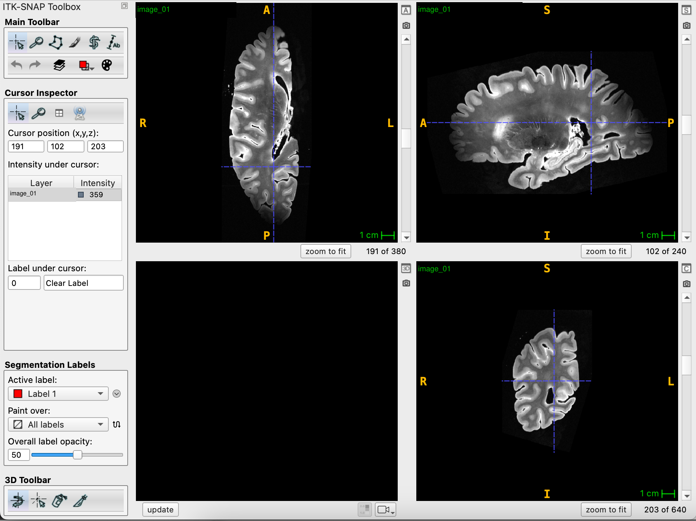
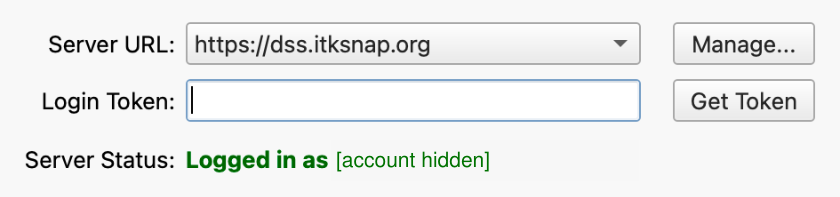
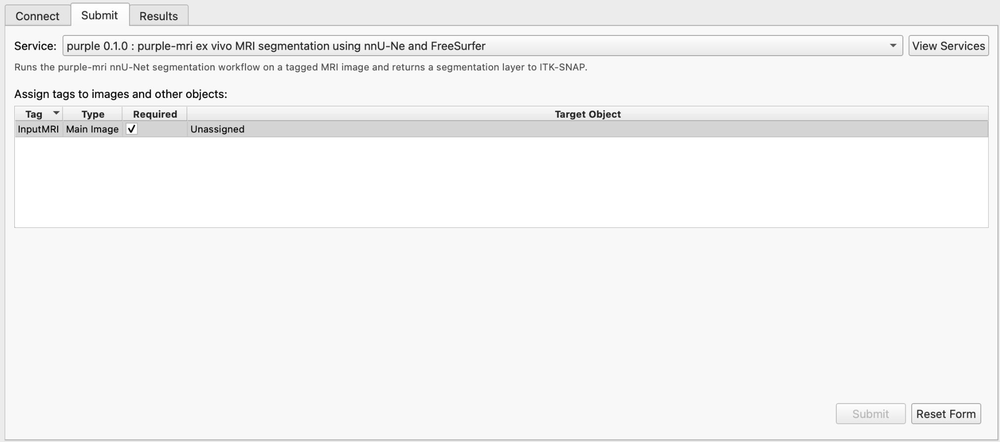
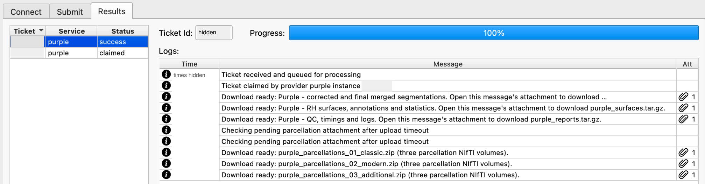

Use ITK-SNAP with the remote DSS service
========================================

Submit a prepared adult ex vivo hemisphere MRI through ITK-SNAP and download
purple-mri results as attachments. Processing runs on the provider's computer.
Your submitting computer needs ITK-SNAP with DSS support, an internet connection,
and access to the service; it does not need the purple-mri Python package,
Docker, a local GPU, or a local FreeSurfer installation.

This walkthrough covers the **purple 0.1.0 RH test service** and its
**six-attachment delivery**. Availability depends on account access and a running
provider. The illustrated form has no hemisphere selector: use a right hemisphere
for this registration. For local LH or RH processing, see :doc:`quickstart`.
Other DSS versions may expose different tags; check :ref:`dss-service-versions`.

Submitting a ticket uploads the MRI to the DSS/provider system. Keep the original
MRI locally: the attachment delivery described here returns results without an
MRI copy or a result workspace. You will open the downloaded labels alongside
your original MRI for QC.

1. Prepare and open the MRI
---------------------------

Use a preprocessed adult ex vivo MRI of one hemisphere. Check anatomical side,
orientation, voxel spacing, coverage, contrast, and obvious tissue or acquisition
problems before submission. This example uses a compressed NIfTI (``.nii.gz``).
Open it as the main image in ITK-SNAP and inspect all three orthogonal planes.
Save any local edits before submitting.

The Docker CLI's ``SUBJECT_0000.nii.gz`` filename convention is separate from
this GUI workflow. DSS identifies the loaded MRI through its assigned image tag;
follow the registered service's requirements. Preserve the link between the
original scan, ticket ID, and downloaded results even if the provider calls the
processed subject ``case``.

   Input MRI before submission. This screenshot does not show a predicted
   segmentation overlay.

2. Connect to DSS
-----------------

Open **Tools → Distributed Segmentation Service** and select **Connect**.
Set **Server URL** to ``https://dss.itksnap.org``. If login is required, click
**Get Token**, complete the browser sign-in, and paste the returned credential
into **Login Token**. Check that **Server Status** confirms the connection.

   The account identifier is hidden and the token field is empty in this example.

3. Select the service and assign the MRI
----------------------------------------

In **Submit**, select the purple-mri entry from **Service**. The illustrated
service is ``purple 0.1.0``; its description identifies purple-mri.

   The DSS service version is independent of the Python package and Docker version.

Assign the main MRI to the required **InputMRI** row using **Target Object**.
Confirm that it no longer says **Unassigned**, then click **Submit**. Record the
ticket ID and the original MRI filename.

   This is the state before assignment. Submit becomes available after required
   inputs are assigned; the generic InputMRI tag does not select a hemisphere.

4. Follow the ticket and download attachments
---------------------------------------------

Select the ticket under **Results**. ``ready`` means queued; ``claimed`` means a
provider has taken the job. Read its logs for processing progress and errors.

Each **Download ready** message has a **paperclip in the Att column**. Use that
paperclip to retrieve its archive. Attachments are delivered separately and may
become available at different times. A download message for one bundle does not
mean the entire run or all uploads have finished.

   The example contains six downloadable result bundles. Identifying ticket,
   time, and provider-instance text has been removed. Earlier upload-retry
   messages are visible before the three parcellation downloads.

For this attachment-based delivery, use the individual paperclips. The generic
DSS **Download** button is for providers that return a result workspace; an
automatically opened workspace is not expected for this workflow.

Extract the archives into a case-specific folder and preserve their directory
structure. Keep the ticket until all expected files have been downloaded and
checked. Deleting a ticket while it is processing or awaiting uploads can
prevent further delivery.

Expected download set
~~~~~~~~~~~~~~~~~~~~~

The six-bundle provider uses the names below. Match them to your ticket's log;
older provider versions may use other names or bundle layouts. In the screenshot,
the segmentation archive's filename is truncated, while its download message
identifies the corrected and final merged results.

.. list-table:: Six result attachments
   :header-rows: 1
   :widths: 42 58

   * - Attachment
     - Contents
   * - ``purple_segmentations.tar.gz``
     - Corrected Purple 10-label and final merged DL NIfTI segmentations.
   * - ``purple_surfaces.tar.gz``
     - Requested-hemisphere surfaces, annotations/labels, color tables, and
       statistics; the illustrated service uses RH.
   * - ``purple_reports.tar.gz``
     - QC reports, timing records, processing logs, and manifests when supplied.
   * - ``purple_parcellations_01_classic.zip``
     - NIfTI atlas volumes: ``aparc``, ``DKTatlas``, ``a2009s``.
   * - ``purple_parcellations_02_modern.zip``
     - NIfTI atlas volumes: ``HCP-MMP1.glasser``,
       ``Schaefer2018_400Parcels_17Networks``, ``brainnetome``.
   * - ``purple_parcellations_03_additional.zip``
     - NIfTI atlas volumes: ``economo``, ``julich``, ``wmparc``.

Together, the three parcellation ZIP files contain eight cortical atlas volumes
and ``wmparc``. See :doc:`parcellation` for atlas meanings and hemisphere
conventions. This provider delivers converted NIfTIs; local Docker surface runs
retain the underlying MGZ volumes unless you export them separately.

Before treating delivery as complete, check the ticket's final status, look for
all six download messages, and verify that every archive extracts and contains
the expected files. A processing success status alone does not establish that
all expected attachments were delivered or that the anatomy is correct.

5. Open labels and perform QC
-----------------------------

Open the corresponding MRI as the main image, then load a downloaded
``.nii.gz`` label map as a segmentation. Select the label-description/color table
for that specific output when provided. The corrected Purple, final merged,
and atlas label maps use different label conventions; do not reuse a label table
indiscriminately.

Compare the output's physical geometry with the MRI. A NIfTI file or a matching
filename alone does not establish spatial alignment. If an atlas is in a
different grid or space, use its appropriate reference and transform; do not
force alignment by changing headers.

Inspect axial, coronal, and sagittal views with adjustable overlay opacity.
Check cortical and deep-structure boundaries, hemisphere identity, cut surfaces,
missing tissue, and disconnected labels. Use a suitable surface viewer for
white/pial surfaces and annotations. Save any manual corrections separately
from the downloaded originals. See :doc:`qc` for the full review checklist.

The repository includes
`ITK-SNAP atlas color tables <https://github.com/Pulkit-Khandelwal/purple-mri/tree/main/visualization/lookup_tables_itksnap>`_.
Use only a table that matches the actual label values and atlas version. These
atlas tables are not universal lookup tables for merged DL segmentations.

Troubleshooting
---------------

.. list-table::
   :header-rows: 1
   :widths: 28 72

   * - Problem
     - Action
   * - Service missing or ticket remains ready
     - Check server URL, account access, and provider availability. A repository
       or a published Docker image does not itself run a DSS provider.
   * - Submit disabled
     - Load the main MRI and assign every required row. In the illustrated form,
       InputMRI must have a Target Object.
   * - Tag or hemisphere error
     - Check the selected registered service and its tag scheme. Do not use
       InputMRI_LH/InputMRI_RH instructions for the illustrated InputMRI-only form.
   * - Results do not open as a workspace
     - Use each download message's paperclip, extract the archives, and load
       labels with the local MRI. This is expected for attachment delivery.
   * - An archive is missing or upload failed
     - Keep the ticket and inspect later retry messages. Report the ticket ID,
       missing bundle, and relevant error to the provider. Avoid resubmitting
       solely to retry an upload; the provider may be able to reuse existing results.
   * - Ticket was deleted
     - Contact the provider before creating another ticket to reuse results.
       The provider must associate results with the correct MRI and active ticket.
   * - Overlay displaced or labels look wrong
     - Check subject identity, spatial geometry, hemisphere, and the label table.
       Review :doc:`outputs`, :doc:`parcellation`, and :doc:`qc`.

.. _dss-service-versions:

Service versions and documentation scope
----------------------------------------

.. list-table:: Service interface recorded on 22 October 2026
   :header-rows: 1
   :widths: 18 32 50

   * - Service
     - MRI tag
     - Scope
   * - ``purple 0.1.0``
     - ``InputMRI``
     - Illustrated existing registration; RH-only backend test.
   * - Proposed ``purple 0.2.0``
     - ``InputMRI_LH`` or ``InputMRI_RH``
     - Repository descriptor requires exactly one hemisphere tag. Its README
       reports activation and validation pending; this guide does not establish
       that it is available on the live server.

The service descriptor version, provider software, Docker image tag, Python
package version, and ITK-SNAP application version are separate identifiers.
Docker/PyPI ``1.1.0`` does not rename the DSS service to ``1.1.0`` or enable LH
submission in the RH-only registration. Follow the form and provider instructions
for the service actually available to your account.

The walkthrough and five redacted screenshots were adapted from the supplied
*purple-mri: Using ITK-SNAP* guide dated 21 October 2026 and the maintainer's
six-attachment delivery record. The screenshots do not establish current queue
availability, timing guarantees, or the ITK-SNAP application version.

The `purple-dss source snapshot
<https://github.com/Pulkit-Khandelwal/purple-dss/tree/548c9d372ec2e7c0f72954713809904967f5baa4>`_
also describes a workspace-return provider implementation. That source and the
`general DSS user tutorial
<https://alfabis-server.readthedocs.io/en/latest/user_quick_start.html>`_
cover other delivery modes; their workspace instructions should not be applied
to the six-attachment example above. The guide documents user interaction and
does not alter provider code, service registration, or backend availability.
