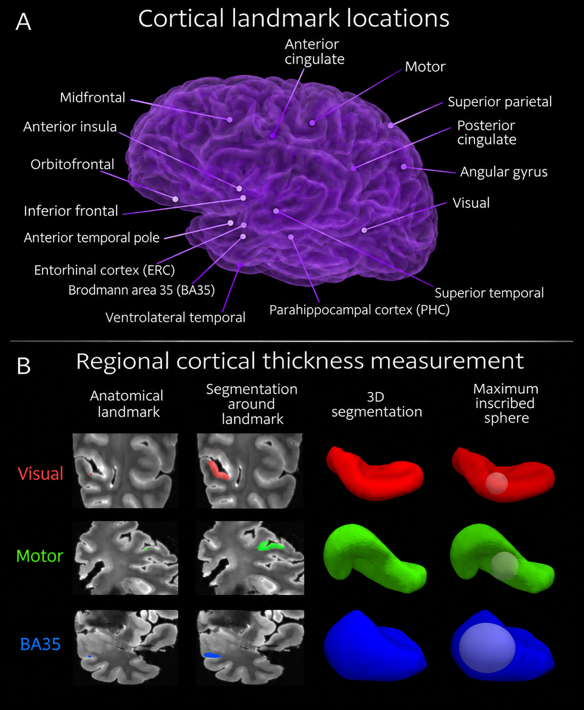

# Thickness via dots

Measure local tissue thickness at labeled anatomical landmarks using regional
segmentations (“pancakes”). Thickness is the diameter of an inscribed sphere,
reported in **millimeters**. This example follows the dot-based workflow in
Khandelwal et al. (2024), *Imaging Neuroscience*.



## 1. Set up

Use Python 3.11 or newer on Linux or macOS. From this folder:

```bash
python3 -m venv .venv
source .venv/bin/activate
python -m pip install -r requirements.txt
```

Place `c3d`, `cmrep_vskel`, `mesh_smooth_curv`, `qvoronoi`,
`skel_tetra_max_thick_sphere`, `tetfill`, and `vtklevelset` in
`binaries/macos/` or `binaries/linux/`.

```bash
# macOS; use binaries/linux/* on Linux
chmod +x binaries/macos/*
bash runme.sh check
```

The platform is selected automatically. To use tools installed elsewhere, set
`DOTS_BIN_DIR=/path/to/binaries`. All workflow commands use `runme.sh`.

## 2. Explore the example

`EXAMPLE001` contains an anonymized dot image and matching manual and automated
regional segmentations. The filenames and NIfTI headers contain no original
specimen identifier. All images retain their original grid and spatial transforms.

| Folder | Contents |
| --- | --- |
| `dots/` | `EXAMPLE001_PMDots.nii.gz`, with all 18 dot labels |
| `manual_edits/` | 18 individual regional files and the combined manual label image |
| `automated_pancakes/` | 18 individual automated regional files |
| `segmentations/` | Put full automated tissue segmentations here when preparing new pancakes |
| `binaries/linux/`, `binaries/macos/` | Platform-specific executables |

Each regional file is named `EXAMPLE001_manualedit_CODE.nii.gz`. Its tissue
voxels carry the corresponding dot ID; for example, `vis` = 1 and `BA35` = 15.
Both manual and automated files use this naming convention.
`manual_edits/EXAMPLE001_all_dots.nii.gz` contains the combined **tissue labels**;
the measurement points are in `dots/`.

**Example QC:** the manual ERC label contains only the 9 dot voxels. Replace
that regional mask with a surrounding tissue segmentation before measuring ERC.
The extractor rejects dot-only masks and leaves their thickness blank. Input
counts and overlap checks are recorded in [EXAMPLE001_QC.csv](examples/EXAMPLE001_QC.csv).

Open the dots and pancakes with the corresponding MRI in ITK-SNAP; load
`PMdots_Labels.txt` for label names and colors. Confirm alignment, dot placement,
and tissue boundaries. An MRI is not included. Use the matching MRI when preparing and reviewing
your own inputs.

## 3. Measure thickness

Run three example regions using the manual pancakes:

```bash
bash runme.sh subj manual_edits EXAMPLE001 work_manual \
  --dots-dir dots --regions vis Mot BA35
```

Run all 18 locations using the supplied automated pancakes:

```bash
bash runme.sh subj automated_pancakes EXAMPLE001 work_auto \
  --dots-dir dots
```

To measure a single location:

```bash
bash runme.sh dot manual_edits EXAMPLE001 BA35 work_one \
  --dots-dir dots
```

Use `--regions` to select locations, or omit it for all labels in `dots.txt`.
Choose a fresh output directory for reruns.

For your own data, replace `EXAMPLE001` consistently in the filenames and
commands. Inputs must share the same image grid and use millimeter units.
If units are unspecified but known to be mm, add `--assume-mm`.
For a 0/1 mask, use `dot ... --seg-file path/to/mask.nii.gz --seg-kind binary`.
Signed level sets use `--seg-kind levelset`, with negative interior and positive
exterior values, or the filename `SPECIMEN_pancake_CODE.nii.gz`.

## 4. Prepare new automated pancakes

The supplied automated pancakes are ready to measure. To make pancakes from a
full automated tissue segmentation, select the tissue label to retain. Here,
label **1** is an example; replace it with the correct tissue ID.

```bash
bash runme.sh prepare \
  --specimen SUBJECT001 \
  --dots dots/SUBJECT001_PMDots.nii.gz \
  --segmentation segmentations/SUBJECT001_seg.nii.gz \
  --tissue-labels 1 \
  --output-dir automated_pancakes
```

For each dot, the code retains the selected tissue within a box of up to
**100 × 100 × 100 voxels**, centered on the first dot voxel and clipped at image
edges. Use `--half-width` to change its size. Each region is saved separately,
with the original image grid preserved. Review the masks, then run:

```bash
bash runme.sh subj automated_pancakes/SUBJECT001 SUBJECT001 work_new \
  --dots-dir dots
```

Use `--all-nonzero` instead of `--tissue-labels` only when every nonzero voxel is
the intended tissue. Overlapping pancakes stay in separate files.

## 5. Review and export

Each specimen has a `results.csv` under `WORK_ROOT/thickness/SPECIMEN/`.
Regional subfolders contain meshes, the selected sphere, maps, and command logs.
See the [reference output](reference_output/README.md) for an anonymized example
and a guide to these files. It uses a different mask version from the bundled inputs.
A compact [sample statistics table](reference_output/EXAMPLE001_stats_table.csv)
shows specimen ID, region, and thickness in mm.
Collect measurements into one table with:

```bash
bash runme.sh stats_table work_manual --output work_manual/thickness.csv
```

The table contains specimen ID, anatomical level, region, layer, thickness in mm,
and QC status. Unavailable measurements are **blank, not zero**. Review the
segmentation boundaries, dot placement, and sphere before accepting values.
Computed values start as `needs_review`; record your decisions in a separate
copy of the table.

For multiple specimens, the `.tsv` files in `examples/` are optional batch
lists: one specimen per row, with tab-separated paths and settings. They contain
no images and are **not required** for the commands above. Run a thickness batch
with `bash runme.sh batch --manifest examples/manual_thickness.tsv --output-dir work_batch`.
Paths in a TSV are relative to that TSV's directory.

For options, run `bash runme.sh COMMAND --help`. To run the code and example-data
checks, use `python -m unittest discover -s tests -v`.

## Dot labels

| ID | Code | ID | Code |
| --- | --- | --- | --- |
| 1 | vis | 10 | atempp |
| 2 | Mot | 11 | vlt |
| 3 | pcin | 12 | sp |
| 4 | mf | 13 | ang |
| 5 | acin | 14 | ERC |
| 6 | orf | 15 | BA35 |
| 7 | stemp | 16 | CA1 |
| 8 | if | 17 | SUB |
| 9 | antin | 18 | PHC |

Use `--labels my_dots.txt` for a custom mapping.

## References

- Khandelwal et al. (2024). *Imaging Neuroscience*.
  [doi:10.1162/imag_a_00171](https://doi.org/10.1162/imag_a_00171).
- Wisse, Ravikumar, et al. (2021). *Acta Neuropathologica Communications*.
  [doi:10.1186/s40478-021-01225-3](https://doi.org/10.1186/s40478-021-01225-3).
- Sadaghiani et al. (2023). *Alzheimer's & Dementia*.
  [doi:10.1002/alz.12884](https://doi.org/10.1002/alz.12884).
- [Convert3D (c3d)](https://github.com/pyushkevich/c3d).
- [Greedy](https://github.com/pyushkevich/greedy).
